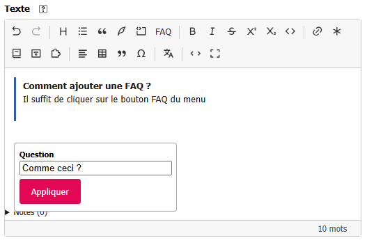

# Build a FAQ extension

This page is for SPIP plugin developers. It starts from the working plugin in
[`exemples/tiptap_spip_faq`](https://github.com/epilibre-design/tiptap_spip/tree/main/exemples/tiptap_spip_faq).
The goal is to add a question-and-answer block to the editor **without changing** `tiptap_spip`.

## Try the example

1. Install and activate **Visual editor for SPIP** first.
2. Copy `exemples/tiptap_spip_faq/` to your SPIP site's `plugins/` directory. Check that
   `plugins/tiptap_spip_faq/paquet.xml` exists.
3. Activate **FAQ for the visual editor (example)** in the plugin manager.
4. Open an article's text. The **FAQ** button appears in the toolbar. Enter a question and an
   answer, save, and check how they appear on the public site.



Edit the answer directly in the block; the **FAQ** button opens the dialog for the question.

In source mode, a block looks like this:

```text
<faq|q=How does the editor work?>
The answer is saved with the article text.
</faq>
```

## 1. Declare a SPIP plugin that depends on the editor

[`paquet.xml`](https://github.com/epilibre-design/tiptap_spip/blob/main/exemples/tiptap_spip_faq/paquet.xml)
declares `<necessite nom="tiptap_spip" />`. It also registers the pipelines that add the script,
button, labels, and styles. A final pipeline, `pre_echappe_html_propre`, turns the shortcut into
HTML for the public site.

For your own plugin, choose a new prefix, rename the folder and PHP functions accordingly, and
adapt the language strings in `lang/`.

## 2. Load the script and add the button

In [`tiptap_spip_faq_pipelines.php`](https://github.com/epilibre-design/tiptap_spip/blob/main/exemples/tiptap_spip_faq/tiptap_spip_faq_pipelines.php),
three pipelines connect the plugin to the editor:

| Pipeline | What it provides |
|---|---|
| `tiptap_spip_extensions` | The JavaScript URL to load before editors start |
| `tiptap_spip_toolbars` | The name `faq` in the `edition` toolbar, after the code block |
| `tiptap_spip_i18n` | Translated labels for the button and dialog |

Labels are translated with `_T()` in the page's interface language: the plugin ships
`lang/tiptap_spip_faq_fr.php` and `lang/tiptap_spip_faq_en.php`. A key added by this pipeline
replaces the editor key of the same name: prefix your keys (`faq_…`) to avoid overwriting one.

The script is registered with `find_in_path('javascript/tiptap_spip_faq.js')`. CSS is loaded in
the private area and on the public site through `header_prive_css` and `insert_head_css`. The
FAQ plugin does not require rebuilding the main plugin's JavaScript.

## 3. Read and write the shortcut in Tiptap

[`javascript/tiptap_spip_faq.js`](https://github.com/epilibre-design/tiptap_spip/blob/main/exemples/tiptap_spip_faq/javascript/tiptap_spip_faq.js)
uses the API exposed by `window.tiptapSpip`. It creates a Tiptap `faqItem` node with:

- `spipTokenizer` to recognize `<faq|q=…>` in SPIP source;
- `parseSpip` to convert the question and answer into an editable node;
- `renderSpip` to write the shortcut when saving;
- `renderHTML` to display the FAQ in the visual area.

The node is registered with `registerExtension(FaqItem, { toolbars: ['edition'] })`. The same
script adds the button with `registerToolbarComponent('faq', …)`; it opens `ui.Popover` to enter
or edit the question. The answer remains directly editable in the block.

Use `window.tiptapSpip.core` for the Tiptap and ProseMirror classes supplied by the editor.
Loading a second copy of those libraries in your plugin can produce incompatible objects.

## 4. Provide public rendering in SPIP

The editor's JavaScript does **not** determine public rendering. The example adds a function to
`pre_echappe_html_propre` that turns `<faq|q=…>…</faq>` into an HTML block with the question as
its heading. SPIP's `propre()` still processes the answer. Because the shortcut resembles a SPIP
model, it must be transformed before SPIP processes models.

The [example CSS](https://github.com/epilibre-design/tiptap_spip/blob/main/exemples/tiptap_spip_faq/css/tiptap_spip_faq.css)
styles the block in the editor and on the site. For your syntax, provide **both sides**: visual
editing and SPIP rendering.

## 5. Check the round trip

At minimum, try these steps on a test site:

1. Enter a FAQ in the editor, save the article, and check its public rendering.
2. Reopen the article, change the question and answer, and save again.
3. Switch to **Source**, check the shortcut, return to visual mode, and save without changes.
4. Deactivate the FAQ plugin and check that the source text remains accessible. FAQ rendering,
   however, depends on the plugin that interprets it.

The repository also contains [tests for the example](https://github.com/epilibre-design/tiptap_spip/blob/main/prive/javascript/tiptap_spip/tests/e2e/faq.e2e.js).
To adapt more complex syntax, see the
[extensibility specification](https://github.com/epilibre-design/tiptap_spip/blob/main/docs/specs/07-extensibilite.md)
(in French).
