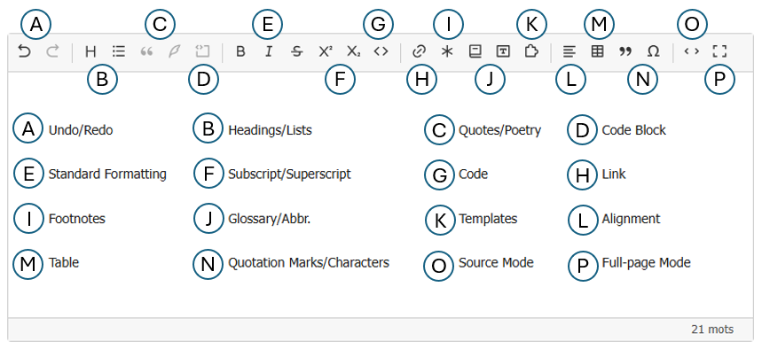

# Getting started

## Edit existing text

1. Open an article in the private area and click **Edit**.
2. Place the cursor in the **Text** field. If the visual editor is enabled for that field, its
   toolbar appears above the text.
3. Select a few words and click **Bold** or **Italic**.
4. Save with the SPIP form button as usual.

The editor shows a representation of the content; the public page still uses SPIP's normal
processing. You can open and edit existing text without a migration step.

## Find your way around the toolbar

The letters in the screenshot identify the following tool groups. Click a tool name for
more detailed instructions.

| Label | Tools | What they do |
|---|---|---|
| **A** | [Undo / Redo](utiliser/contenus-spip.md#a-few-keyboard-shortcuts) | Undo the last change or restore an undone change. |
| **B** | [Headings / Lists](utiliser/contenus-spip.md#headings-and-lists) | Turn paragraphs into headings, bulleted lists, or numbered lists; indent list items. |
| **C** | [Quote / Poetry](utiliser/contenus-spip.md#quotations-and-poetry) | Present a quotation or preserve line breaks in a poetry passage. |
| **D** | [Code block](utiliser/contenus-spip.md#a-block-of-several-lines) | Enter a code example on several lines without interpreting its SPIP syntax. |
| **E** | [Bold / Italic / Strikethrough](utiliser/contenus-spip.md#formatting) | Apply or remove these effects on selected words. |
| **F** | [Superscript / Subscript](utiliser/contenus-spip.md#formatting) | Raise or lower selected characters. |
| **G** | [Code](utiliser/contenus-spip.md#a-short-code-excerpt-within-a-sentence) | Display a short code excerpt within a sentence. |
| **H** | [Link](utiliser/contenus-spip.md#links-to-a-page-or-document) | Create or edit a link to a web address, article, section, or site document. |
| **I** | [Footnote](utiliser/notes-de-bas-de-page.md) | Insert a note and edit its content in a dedicated dialog. |
| **J** | [Glossary](utiliser/contenus-spip.md#notes-and-glossaries) / Abbreviation | Link a term to its definition; provide the expansion of an abbreviation. |
| **K** | [Model](utiliser/contenus-spip.md#images-documents-and-other-models) | Insert a SPIP model using its syntax or the catalog, when available. |
| **L** | [Alignment](utiliser/contenus-spip.md#formatting) | Align text blocks to the left, center, or right, or justify them. |
| **M** | [Table](utiliser/tableaux.md) | Create a table and manage rows, columns, headers, and merged cells. |
| **N** | [Quotation marks / Characters](utiliser/contenus-spip.md#formatting) | Surround selected text with quotation marks or insert a special character. |
| **O** | [Source](#switch-to-source-and-back) | View and edit the article's SPIP syntax, then return to visual mode. |
| **P** | [Full screen](#expand-the-writing-area) | Expand the writing area for more space. |

Hover over a button to see its name and keyboard shortcut, if it has one.
Depending on the configuration and content, the toolbar may also offer
[Multilingual and displayed-language tools](utiliser/multilinguisme.md), which are absent from this screenshot.

The toolbar stays visible as you scroll through the form. Available buttons depend on the field:
a forum comment, for example, has a shorter toolbar than an article.

## Switch to source and back

Click **Source** to view and edit SPIP syntax, such as `{{bold}}` or `[text->art12]`. Click it
again to return to the visual view. The editor then reads the source text again. Your mode choice
is remembered in this browser; an administrator can also choose the site's
[initial mode](configurer.md).

If a particular fragment appears as code in the visual view, click it or switch to **Source** to
correct it. [Syntax issues](utiliser/erreurs-de-syntaxe.md) are shown below the editor.

## Expand the writing area

The **Full screen** button expands the editor; press **Esc** to return to the form. In a link or
note dialog, **Esc** closes the open dialog first.

For more, see [SPIP content](utiliser/contenus-spip.md).
