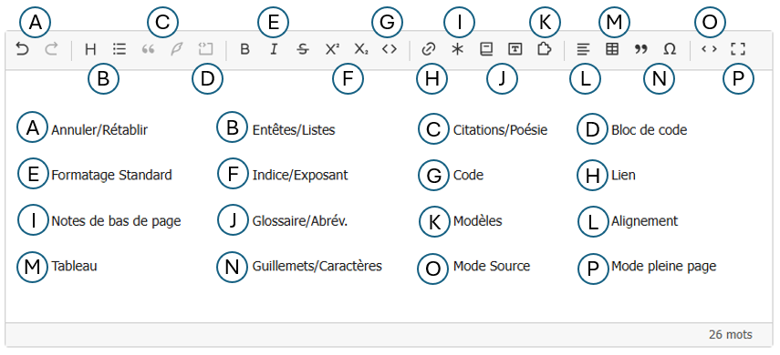

# Premiers pas

## Modifier un texte existant

1. Ouvrez un article dans l’espace privé et cliquez sur **Modifier**.
2. Placez le curseur dans le champ **Texte**. Si l’éditeur visuel est activé sur ce champ,
   la barre d’outils s’affiche au-dessus du texte.
3. Sélectionnez quelques mots, puis cliquez sur **Gras** ou **Italique**.
4. Enregistrez avec le bouton du formulaire SPIP, comme d’habitude.

L’éditeur vous montre une représentation du contenu ; la page publique continue d’utiliser les
traitements habituels de SPIP. Les textes déjà enregistrés peuvent être ouverts et modifiés sans
étape de migration.

## Se repérer dans la barre

Le menu **Titre** choisit un intertitre ; **Liste** crée des puces ou des numéros. Les boutons
**Lien**, **Note**, **Glossaire**, **Modèle**, **Multilingue** et **Tableau** ouvrent les outils adaptés au
contenu. Survolez un bouton pour lire son nom et, lorsqu’il existe, son raccourci clavier.

La barre reste visible pendant le défilement du formulaire. Les boutons disponibles dépendent du
champ : un commentaire de forum, par exemple, a une barre plus courte qu’un article.

## Passer en source et revenir

Cliquez sur **Source** pour voir et modifier les raccourcis SPIP, par exemple `{{gras}}` ou
`[texte->art12]`. Cliquez de nouveau pour revenir à l’affichage visuel. L’éditeur relit alors le
texte source. Votre choix de mode est mémorisé dans ce navigateur ; un administrateur peut aussi
choisir le [mode initial du site](configurer.md).

Si un fragment particulier reste affiché comme du code dans la vue visuelle, ouvrez-le en cliquant
dessus ou passez en **Source** pour le corriger. Les [anomalies de syntaxe](utiliser/erreurs-de-syntaxe.md) sont indiquées
sous l’éditeur.

## Agrandir la zone d’écriture

Le bouton **Plein écran** agrandit l’éditeur ; appuyez sur **Échap** pour revenir au formulaire.
Dans les fenêtres de lien ou de note, **Échap** ferme d’abord la fenêtre ouverte.

Pour aller plus loin, voir [Contenu SPIP](utiliser/contenus-spip.md).
