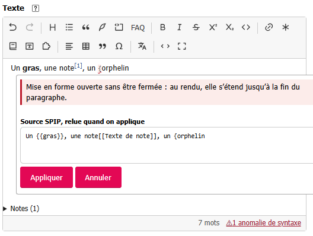

# Find syntax issues

An incomplete SPIP shortcut can change how text is rendered. The editor keeps the passage as
source and marks some issues with a wavy underline. The count appears below the editor.

Click the count to open the next issue. The dialog explains what may happen and shows the SPIP
source to correct. Edit it, then click **Appliquer** (Apply).

## Shortcuts that are flagged

The editor recognizes, for example:

- an opening delimiter without a closing one, such as `{`, `{{`, or `<strong>`;
- a closing delimiter without an opening one, such as `}`, `}}`, or `</quote>`;
- an incomplete heading starting with `{{{`;
- an unclosed `<quote>`;
- an unclosed SPIP block tag, such as `<multi>`, `<cadre>`, or `<html>`.

These issues can extend formatting or a quotation into following text, or leave a tag untreated
when SPIP renders the page.

## Limits

The count does not cover every incomplete shortcut: a malformed link, model, note, or table may
remain as source without being flagged. HTML the editor does not handle, an entity such as
`&nbsp;`, and empty braces such as `{}` are not issues either. When several nested shortcuts
remain as source, each delimiter may be counted separately.
