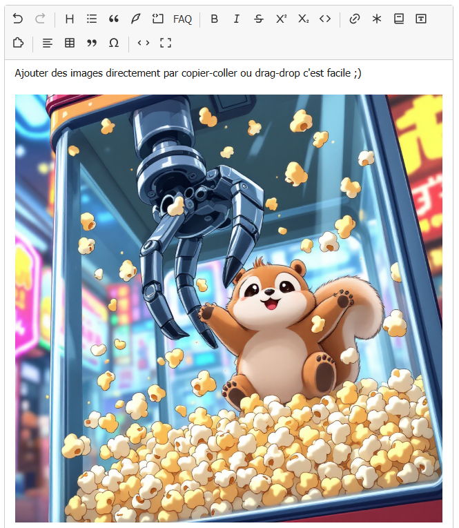

# Coller des images et déposer des fichiers

Vous pouvez ajouter une ou plusieurs images directement dans un article, sans passer par la boîte
« Documents » : copiez-les puis collez-les dans l’éditeur, ou glissez-les depuis votre ordinateur.
Le glisser-déposer accepte aussi les autres types de documents autorisés par votre site, comme les PDF.
Chaque fichier envoyé devient un document SPIP lié à l’article en cours d’édition. L’éditeur insère
son raccourci `<docN>` dans le texte.

!!! note "Avant de commencer"
    Le plugin **Médias** doit être actif et l’option **Coller des images et déposer des documents**
    doit être activée dans [la configuration de l’éditeur](../configurer.md#activer-ou-desactiver-lenvoi-de-fichiers). Il faut aussi avoir
    le droit de joindre des documents à l’article. Les types et tailles acceptés dépendent des
    réglages du site.

## Dans l’éditeur visuel

Placez le curseur où vous voulez insérer l’image. Copiez une image ou plusieurs fichiers image,
puis collez-les avec **Ctrl+V** (ou **⌘+V** sur Mac). Chaque image acceptée est envoyée dans l’ordre
et un indicateur apparaît à sa place pendant l’envoi. Une fois l’envoi terminé, il est remplacé
par l’aperçu du modèle SPIP `<docN>`. Si vous aviez sélectionné du texte, celui-ci est conservé :
les images s’ajoutent après la sélection.

Pour déposer des fichiers, glissez-en un ou plusieurs sur la zone de l’éditeur. L’indication
**Déposer les fichiers** apparaît au survol. Relâchez la souris à l’endroit voulu : les fichiers
sont traités dans l’ordre et chacun reçoit son raccourci. Un dépôt sur un bloc de code place les
raccourcis après ce bloc. Vous pouvez déposer des images et d’autres documents acceptés par SPIP
dans le même geste.

Le collage privilégie le texte ou le HTML lorsque le presse-papiers contient aussi un véritable
passage de texte : ce passage est collé normalement et les images jointes sont ignorées. Le dépôt,
lui, traite les fichiers même lorsqu’ils sont accompagnés de texte ou de HTML.

## Dans l’édition du code source

Cliquez sur **Source** pour modifier directement les raccourcis SPIP. Le collage d’une ou plusieurs
images fonctionne aussi dans cette zone. Pendant chaque envoi, un repère provisoire
`<!-- envoi… -->` apparaît après le curseur ou le texte sélectionné. Il est remplacé par `<docN>`
quand l’envoi aboutit. Le texte sélectionné reste en place.

Le glisser-déposer fonctionne également en mode source. Les raccourcis sont insérés **après la
sélection du texte**, quelle que soit la position de la souris dans la zone de code : un champ
texte ne donne pas à l’éditeur le point précis du dépôt. Le survol affiche la même indication
**Déposer les fichiers**.

Pendant un envoi, vous pouvez continuer à écrire. La bascule entre les modes est temporairement
bloquée pour conserver les repères au bon endroit. Si vous cliquez sur **Enregistrer**, l’éditeur
attend la fin des envois avant de soumettre le formulaire ; **Enregistrer sans attendre** les
abandonne et enregistre le texte sans repère provisoire. Un échec est indiqué sous l’éditeur et
n’insère aucun raccourci.

## Avec Crayons

Le collage d’images fonctionne aussi dans un article modifié avec **Crayons**, lorsque l’éditeur
visuel est [activé dans les crayons](../configurer.md#choisir-ou-lediteur-apparait). Dans les deux
modes, l’éditeur gère le dépôt sur sa zone : chaque document est lié à l’article et son raccourci
`<docN>` est inséré dans le texte. En mode source, il se place après la sélection.

Si l’option expérimentale de dépôt de **Crayons** (`crayons/upload`) est activée, elle conserve sa
propre zone de dépôt dans le panneau latéral. Un fichier déposé sur ce panneau est géré par
Crayons ; son raccourci apparaît dans le panneau et n’est pas inséré automatiquement dans le
texte. Si l’éditeur visuel est désactivé dans les crayons, Crayons conserve aussi son comportement
habituel sur la zone de texte.
