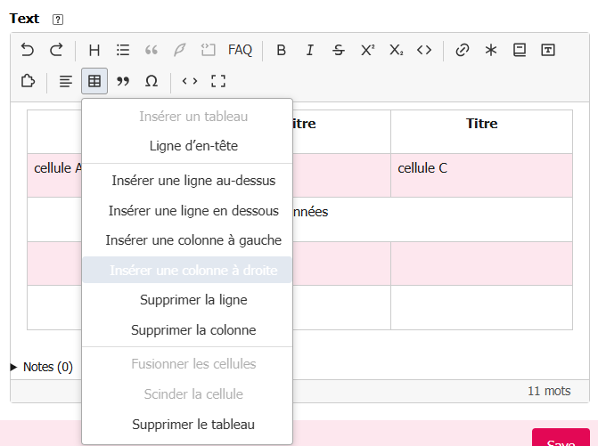

# Mettre en forme

Sélectionnez le texte à modifier, puis choisissez un outil dans la barre. Pour un nouveau
paragraphe ou un nouvel élément de liste, placez simplement le curseur à l’endroit voulu.

| Ce que vous voulez faire | Outil à utiliser |
|---|---|
| Mettre quelques mots en valeur | **Gras**, **Italique**, **Barré**, **Exposant** ou **Indice** |
| Créer un titre dans le texte | Menu **Titre**, puis un niveau proposé |
| Faire une liste | Menu **Liste** : puces, numéros, indentation |
| Insérer une citation ou un extrait de code | **Citation** ou **Bloc de code** |
| Aligner un paragraphe | Menu **Alignement** |
| Insérer des guillemets ou des caractères spéciaux | Menus **Guillemets** et **Caractères** |
| Créer un tableau | Menu **Tableau**, puis **Insérer un tableau** |

## Titres, listes et tableaux

Le niveau **Intertitre** correspond au titre SPIP habituel. Les niveaux supplémentaires sont
disponibles si l’administrateur les a conservés dans la [configuration](../configurer.md).

Dans une liste, **Tab** indente un élément et **Maj+Tab** le désindente. 

Pour un tableau, placez le curseur dans une cellule avant de rouvrir **Tableau** : 
vous pouvez ajouter ou supprimer une ligne ou une colonne, ajouter une ligne d’en-tête, 
fusionner ou séparer des cellules.

## Quelques raccourcis clavier

Sur Mac, utilisez **⌘** à la place de **Ctrl**.

| Action | Raccourci |
|---|---|
| Gras / italique | Ctrl+B / Ctrl+I |
| Insérer un lien | Ctrl+K |
| Annuler / rétablir | Ctrl+Z / Ctrl+Maj+Z |
| Passer en source ou revenir au visuel | Ctrl+Maj+E |
| Agrandir l’éditeur | F11 quand le curseur est dans l’éditeur |

Les autres raccourcis sont indiqués dans l’infobulle de leur bouton.
