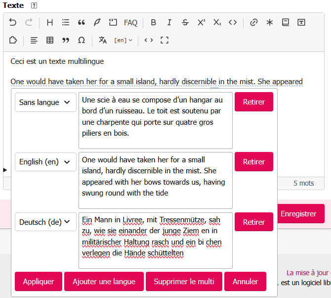

# Use multis

A **multi** contains several versions of the same passage, each for a different language. SPIP stores them in a `<multi>…</multi>` shortcut; the editor lets you create and change them without writing the shortcut yourself.

## Show the Multi button

In SPIP’s private area, open **Configuration → Multilingual**, enable at least two languages, and save. Reload the editing page: the **Multi** button appears in the editor toolbar. It also remains available when the text already contains a multi, even if the site now offers only one language.

The multi window lists languages enabled in this configuration. A language already used by an existing multi remains available for that version, even if it has since been disabled.

## Switch the displayed language while editing

When the text contains a multi, the toolbar shows a language menu such as **[en]**. Open it and choose a language used in the text. For an inline multi, the editor shows the corresponding version; for a multi spanning several paragraphs, it dims the other versions.

This choice helps you review and edit each version in the editor. It does not change the article’s language or the saved text. All versions remain in the same `<multi>`.

## Create an inline multi

1. Select the words that need several language versions, then click **Multi**. The selection becomes the first version, and a second empty version is added.
2. Choose each version’s language from its list and enter its text. **Add a language** creates another version; **Remove** deletes that row.
3. Click **Apply** to insert the multi into the editor, then save the article with the SPIP form.

The first version uses the displayed language if it is enabled; otherwise it uses the first available language. A new version uses the first enabled language not already taken. **No language** is the default version, shown when no version matches the requested language.



To change an inline multi, select it and open **Multi**. **Remove the multi** removes the shortcut while keeping the version currently displayed in the text.

## Create or change a multi spanning several paragraphs

Place the cursor in an empty paragraph and click **Multi**. Choose the first version’s language, then click **Apply**. You can now write in the new block. To add more versions, place the cursor inside the block, reopen **Multi**, click **Add a language**, choose a language and apply. Write in each part directly in the editor.

In a multi spanning several paragraphs, the **Multi** window manages languages and removes parts; edit each part’s text directly in the editor. **Remove the multi** removes the container and keeps the paragraphs in the currently displayed language.

In source mode, a multi can look like this:

```text
<multi>[fr]Bonjour[en]Hello</multi>
```

Switch to [source mode](../premiers-pas.md#switch-to-source-and-back) to inspect the complete shortcut.
