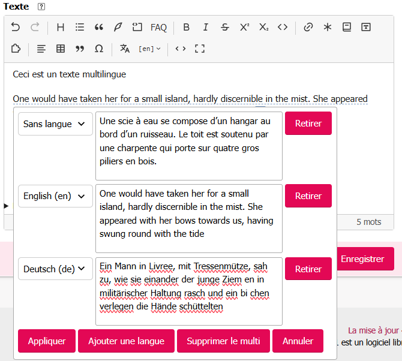

# Utiliser les multis

Un **multi** contient plusieurs versions d’un même passage, chacune destinée à une langue. SPIP conserve ces versions dans le raccourci `<multi>…</multi>` ; l’éditeur vous permet de les créer et de les modifier sans écrire ce raccourci à la main.

## Faire apparaître le bouton Multilingue

Dans l’espace privé de SPIP, ouvrez **Configuration → Multilinguisme**, cochez au moins deux langues et enregistrez. Rechargez ensuite la page d’édition : le bouton **Multilingue** apparaît dans la barre de l’éditeur. Il reste aussi disponible lorsque le texte contient déjà un multi, même si le site ne propose plus qu’une langue.

La fenêtre d’édition du multi propose les langues activées dans cette configuration. Une langue utilisée par un multi existant reste proposée pour sa version, même si elle a été désactivée depuis.

## Changer la langue affichée pendant l’édition

Lorsque le texte contient un multi, la barre affiche un menu de langue, par exemple **[en]**. Ouvrez-le et choisissez une langue présente dans le texte. Dans un multi en ligne, l’éditeur montre la version correspondant à cette langue ; dans un multi sur plusieurs paragraphes, il estompe les autres versions.

Ce choix sert à relire et à modifier les différentes versions dans l’éditeur. Il ne change ni la langue de l’article ni le texte enregistré. Les versions restent toutes dans le même `<multi>`.

## Créer un multi en ligne

1. Sélectionnez les mots à décliner en plusieurs langues, puis cliquez sur **Multilingue**. Le texte sélectionné devient la première version. Une deuxième version vide est ajoutée.
2. Choisissez la langue de chaque version dans sa liste et saisissez le texte correspondant. **Ajouter une langue** crée une autre version ; **Retirer** supprime la ligne concernée.
3. Cliquez sur **Appliquer** pour insérer le multi dans l’éditeur, puis enregistrez l’article avec le formulaire SPIP.

La première version prend la langue affichée si elle fait partie des langues activées ; sinon, elle prend la première langue proposée. Une nouvelle version prend la première langue activée qui n’est pas déjà utilisée. **Sans langue** désigne la version par défaut, affichée lorsqu’aucune version de la langue demandée ne convient.



Pour modifier un multi en ligne, sélectionnez-le et ouvrez **Multilingue**. Le bouton **Supprimer le multi** retire les balises et garde dans le texte la version actuellement affichée.

## Créer ou modifier un multi sur plusieurs paragraphes

Placez le curseur dans un paragraphe vide et cliquez sur **Multilingue** : choisissez la langue de la première version, puis cliquez sur **Appliquer**. Vous pouvez alors écrire dans ce nouveau bloc. Pour ajouter d’autres versions, placez le curseur dans le bloc, rouvrez **Multilingue**, cliquez sur **Ajouter une langue**, choisissez la langue et appliquez. Écrivez ensuite dans chaque partie directement dans l’éditeur.

Dans un multi de plusieurs paragraphes, la fenêtre **Multilingue** sert à gérer les langues et à retirer des parties ; le texte de chaque partie se modifie dans l’éditeur. **Supprimer le multi** retire le conteneur en gardant les paragraphes de la langue affichée.

En mode source, un multi peut ressembler à ceci :

```text
<multi>[fr]Bonjour[en]Hello</multi>
```

Pour revoir le raccourci complet, passez en [mode source](../premiers-pas.md#passer-en-source-et-revenir).
