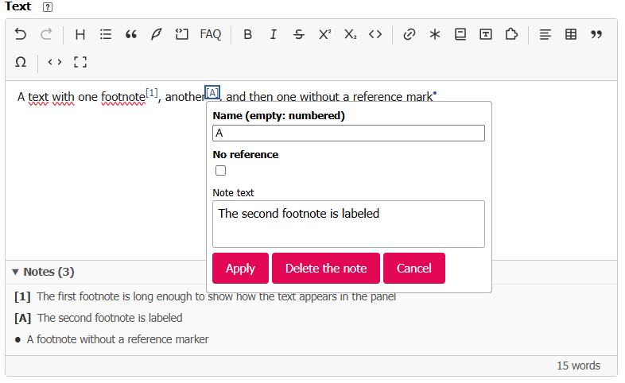

# Enter footnotes

The **Note** button inserts a footnote in the text. The editor shows its reference marker and
collects the notes in a panel below the editing area.

## Create a footnote

Place the cursor where you want the reference marker, then click **Note**. If you select text
within one paragraph first, that text becomes the note's content. Enter or edit the **Note text**,
then click **Apply**. Save the article with the SPIP form afterwards.

The **Name** field is optional: leave it empty for an automatically numbered reference such as
**[1]**. Enter a name to show it in place of the number, for example **[A]**. Check **No reference**
to keep the note without a marker in the text; the **Name** field is then disabled. The note text
cannot be empty.

The **Note text** area is a small editor: it supports formatting, links, lists, and more. It has
no toolbar of its own and does not allow notes inside notes.

## Edit or delete a footnote

Click its reference marker in the text or its entry in the **Notes** panel below the editor.
Change its name, **No reference** option, or text, then click **Apply**. To remove it, click
**Delete the note**. The panel updates as the notes change; it is hidden when there are no notes
or when you switch to source mode.

In [source mode](../premiers-pas.md#switch-to-source-and-back), a numbered note is written
`[[Note text]]`, a named note `[[<A>Note text]]`, and a note without a reference
`[[<>Note text]]`.
