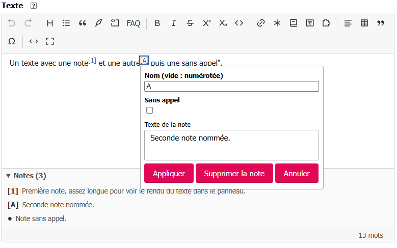

# Saisir des notes de bas de page

Le bouton **Note** insère une note dans le texte. L’éditeur affiche son appel et rassemble les notes
dans un panneau sous la zone de saisie.

## Créer une note

Placez le curseur à l’endroit de l’appel, puis cliquez sur **Note**. Si vous sélectionnez du texte
dans un même paragraphe avant de cliquer, ce texte devient le contenu de la note. Saisissez ou
modifiez le **Texte de la note**, puis cliquez sur **Appliquer**. Enregistrez ensuite l’article avec
le formulaire SPIP.

Le champ **Nom** est facultatif : laissez-le vide pour obtenir un appel numéroté automatiquement,
comme **[1]**. Saisissez un nom pour afficher cet appel à la place du numéro, par exemple **[A]**.
Cochez **Sans appel** pour conserver la note sans marque dans le texte ; le champ **Nom** est alors
désactivé. Le texte de la note ne peut pas être vide.

La zone **Texte de la note** est un petit éditeur : elle accepte notamment la mise en forme, les
liens et les listes. Elle ne possède pas sa propre barre d’outils et ne permet pas d’imbriquer une
note dans une autre.

## Modifier ou supprimer une note

Cliquez sur l’appel dans le texte ou sur la note dans le panneau **Notes** sous l’éditeur. Modifiez
son nom, son option **Sans appel** ou son texte, puis cliquez sur **Appliquer**. Pour l’enlever,
cliquez sur **Supprimer la note**. Le panneau se met à jour avec les notes du texte ; il est masqué
quand il n’y en a aucune ou quand vous passez en mode source.

En [mode source](../premiers-pas.md#passer-en-source-et-revenir), une note numérotée s’écrit
`[[Texte de la note]]`, une note nommée `[[<A>Texte de la note]]` et une note sans appel
`[[<>Texte de la note]]`.
