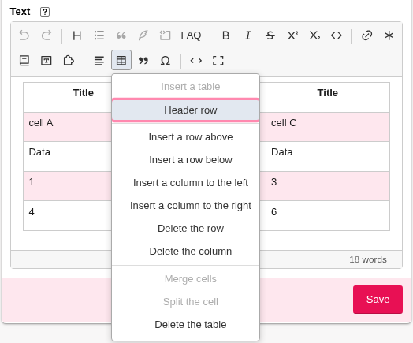

# Tables

The **Table** menu creates and edits tables in visual mode. Data is still saved as SPIP syntax,
which you can inspect with **Source**.

## Create a table and fill its cells

1. Place the cursor where you want the table, outside an existing table.
2. Open **Table → Insert a table**. The editor creates **three rows and three columns**,
   with no header row at insertion time.
3. Click a cell and enter its content.
4. Use **Tab** to move to the next cell and **Shift+Tab** to return to the previous one.
   In the last cell, **Tab** adds a row and moves the cursor to its first cell.

Select text within a cell to apply bold, italics, or a link, as in a paragraph. Each cell holds
one paragraph: lists, headings, and code blocks cannot be placed inside it.



## Add or delete rows and columns

Place the cursor in a cell, then reopen **Table**. Commands act relative to that cell;
commands that do not apply to the selection are disabled.

| Action | Command in the Table menu |
|---|---|
| Add a row before the current row | **Insert a row above** |
| Add a row after the current row | **Insert a row below** |
| Add a column before the current column | **Insert a column to the left** |
| Add a column after the current column | **Insert a column to the right** |
| Remove the current row or column and its content | **Delete the row** or **Delete the column** |
| Remove the entire table and its content | **Delete the table** |

If you make a mistake, use **Undo** (**Ctrl+Z**, or **⌘+Z** on a Mac).

## Set the header row

Place the cursor in the table and choose **Table → Header row**. This converts **the existing
first row** into a header; it does not add a row. Click it again to remove the header.

The header covers the whole first row. The editor does not offer headers limited to a column
or individual cells: it follows native SPIP table syntax. New columns use the same cell type
as this first row; subsequent rows remain data rows.

An entirely empty first row may be recognized as a header when returning from source mode.
Fill in that row's cells to make the table content explicit.

## Merge and split cells

1. Click the first cell, then hold **Shift** and click the last cell in the rectangle you want
   to merge. You can also drag from one cell to another.
2. Check that the cells themselves are selected, rather than just their text.
3. Choose **Table → Merge cells**.

Cells can be merged horizontally or vertically. Their text is combined into one paragraph,
separated by spaces. The command is disabled if the selection cannot be merged.

To split a merged cell, place the cursor inside it and choose **Table → Split the cell**.
The text stays in the first cell; the others are empty. To restore the original distribution
of text immediately after a merge, use **Undo** instead.

## When to use source mode

Creating the table, typing, setting its header, adding or deleting rows and columns, and merging
cells all work in visual mode. Use **Source** to add or edit the **caption** and **summary**:
the toolbar currently has no commands for these.

### Add a caption and summary

Click **Source**, then add a line `||Caption|Summary||` immediately before the table rows,
with no blank line between them:

```text
||Opening hours|Days and times for visitors||
|{{Day}}|{{Morning}}|{{Afternoon}}|
|Monday|9 am – noon|2 pm – 5 pm|
|Tuesday|9 am – noon|2 pm – 5 pm|
```

For a caption alone, write `||Opening hours||`.
The caption and summary are preserved when you return to visual mode and edit cells,
but they are not displayed in the editor's grid. Their public rendering depends on SPIP
and the site's styles; the summary is not necessarily visible text.

### Understand or fix the syntax

Each table row starts and ends with `|`; cells are separated by `|`. All data rows must have
the same number of cell positions. A merged cell also counts the positions it covers:
`<` extends the cell to its left, and `^` extends the one above it. Visual commands write
these markers for you.

A table with inconsistent rows or invalid merges may appear as a raw fragment. Click the
fragment to correct its text, or switch to **Source**. See also [Syntax issues](erreurs-de-syntaxe.md).

### Limits of visual tables

Column widths cannot be adjusted by dragging their borders. Native SPIP tables also do not
describe cell colors, borders, or content made up of several blocks. Switching to source
mode does not make these options available in the visual grid. For a particular presentation,
use the site's styles; an HTML table written in source mode does not offer the same visual
editing commands as a SPIP table.
